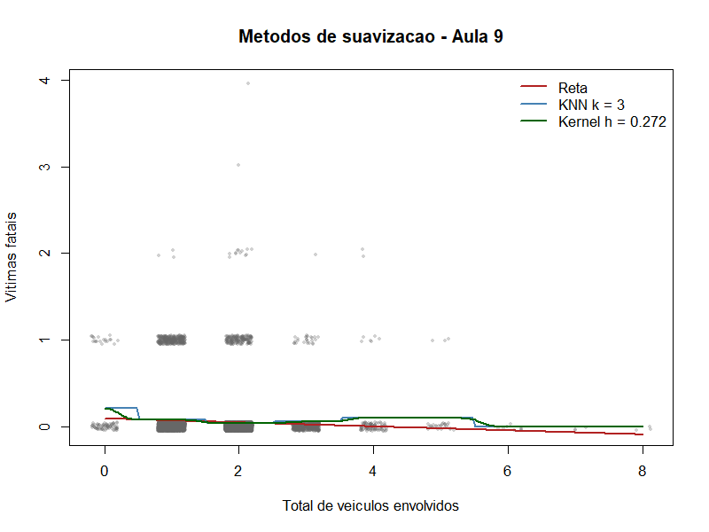

# Atividade 08: Métodos de Suavização (Aula 09)

Esta atividade aplica três métodos preditivos para um preditor numérico e a variável resposta, explorando Reta, KNN e Kernel Smoothing para identificar formas funcionais não lineares nos dados do projeto.

## Parâmetros e resultados da validação cruzada

O modelo utilizou **`veiculos`** (quantidade de veículos envolvidos) como preditor (`x`) e **`qtd_gravidade_fatal`** como resposta (`y`), numa amostra de 10.000 boletins do recorte de modelagem (151.175, sem marcadores `NAO DISPONIVEL`). Os números abaixo vêm de [2026-10-09-appa-08-ResumoSuavizacao.csv](../estrutura/codigos/resultados/2026-10-09-appa-08-ResumoSuavizacao.csv) e do placar completo em [2026-10-09-appa-08-PlacarSuavizacao.csv](../estrutura/codigos/resultados/2026-10-09-appa-08-PlacarSuavizacao.csv), ambos gerados pelo script.

| Método | Melhor hiperparâmetro | MSE de validação cruzada (5 dobras) |
|---|---|---:|
| Média | — | 0,05828 |
| Reta de regressão | — | 0,05804 |
| KNN | k = 3 | 0,05768 |
| Kernel (Nadaraya-Watson) | h ≈ 0,272 | 0,05768 |

## Cuidados na leitura

- `veiculos` assume só **9 valores distintos** na amostra. Com tão poucos valores de x, KNN e kernel viram praticamente uma média por valor de x: todos os vizinhos empatados entram na média (o desempate por índice foi removido) e h pequenos dão o mesmo resultado que k = 3.
- O melhor k (3) está na **borda** da grade testada; a diferença entre k = 3 e k = 40 é da quarta casa decimal.
- Todos os hiperparâmetros são avaliados nos mesmos pontos: se algum ponto de validação ficasse sem previsão, o erro daquele hiperparâmetro seria `NA` e ele seria descartado, em vez de ser comparado em um subconjunto mais fácil.

## Visualização

A figura mostra a reta, o KNN e o kernel com os hiperparâmetros escolhidos pela validação cruzada, sobre os pontos (com um pequeno deslocamento visual para separar sobreposições).

## Conclusão de forma

As diferenças entre média, reta, KNN e kernel são de cerca de 1% do MSE. Com um preditor discreto e quase sem relação com uma resposta 94% zero, não há evidência de não linearidade: **ficamos com a reta** (ou até com a média), pelo critério de parcimônia, por erros praticamente idênticos.
